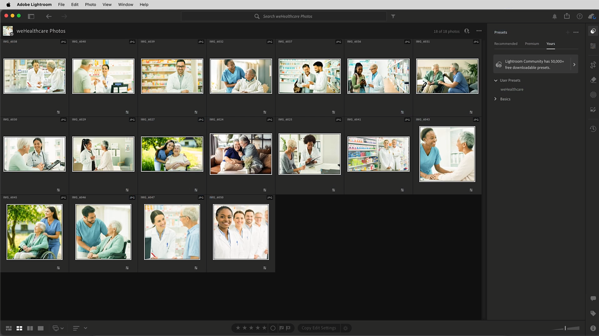
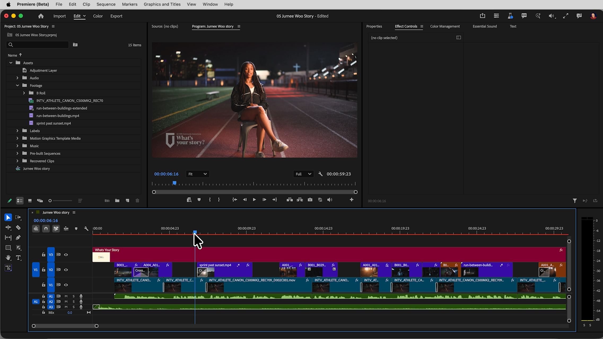

# Esercitazioni per l&#39;intelligenza artificiale di Creative Cloud for enterprise

Esplora i tutorial che possono aiutarti a scoprire idee, creare contenuti e semplificare i flussi di lavoro creativi utilizzando l&#39;intelligenza artificiale in Creative Cloud. Queste esercitazioni sono raggruppate per ruolo: Designer grafico, Director creativo/artistico, Photoshop Artist/Retoucher ed Editor video.

## Designer grafico

<table style="table-layout:fixed">
<tr>
 <td>
   
    

   <a href="turn-flat-vector-art.md"><strong>Trasforma la grafica vettoriale piatta in qualsiasi angolazione, senza ridisegnarla</strong></a>
    

    <em>Scopri come utilizzare il testo per creare pattern in Illustrator</em>
     
  </td>
  <td>
   
    

   <a href="seamless-vector.md"><strong>Modelli vettoriali uniformi in pochi minuti, non in ore</strong></a>
    

    <em>Scopri come creare un modello di marchio uniforme in Illustrator senza dover controllare manualmente ogni bordo ripetuto</em>
     
  </td>
  <td>
    
    

     
  </td>
  <td>
    
    

     
  </td>
</tr>
</table>

## Director creativo/artistico

<table style="table-layout:fixed">
<tr>
  <td>
   
    

   <a href="one-brief.md"><strong>20 indicazioni da un breve, prima del pranzo</strong></a>
    

    <em>Scopri come trasformare un suggerimento creativo in una bacheca condivisa con direzioni visive dinamiche</em>
     
  </td>
  <td>
   
    

   <a href="brief-to-storyboard.md"><strong>Da breve a storyboard: esplorare le indicazioni video prima della produzione</strong></a>
    

    <em>Scopri come trasformare un suggerimento creativo in una bacheca condivisa con direzioni visive dinamiche</em>
     
  </td>
  <td>
    
    

     
  </td>
  <td>
    
    

     
  </td>
</tr>
</table>

## Artista/Ritoccatore Photoshop

<table style="table-layout:fixed">
<tr>
  <td>
   
    

   <a href="retouch-faster.md"><strong>Ritoccare più velocemente e mantenere i pixel originali</strong></a>
    

    <em>Scopri come aggiungere ombre naturali a una foto di prodotto in Photoshop mantenendo intatti i pixel originali</em>
     
  </td>
  <td>
   
    

   <a href="build-presets.md"><strong>Generare predefiniti per uniformare il colore in uno scatto</strong></a>
    

    <em>Scopri come conferire a un intero servizio fotografico un aspetto uniforme senza modificare ogni immagine una alla volta</em>
     
  </td>
  <td>
    
    

     
  </td>
  <td>
    
    

     
  </td>
</tr>
</table>

## Editor video

<table style="table-layout:fixed">
<tr>
  <td>
   
    

   <a href="fill-gaps.md"><strong>Riempire gli spazi vuoti nel taglio: B-roll, audio e clip che terminano troppo presto</strong></a>
    

    <em>Scopri come utilizzare Generative Extend in Premiere</em>
     
  </td>
 <td>
   
    

   <a href="rough-cut.m"><strong>Passate più rapidamente al taglio di prova</strong></a>
    

    <em>Scoprite come creare un taglio di prova dalle interviste e far scorrere rapidamente il video in Premiere, senza scorrere ogni clip</em>
     
  </td>
  <td>
    
    

     
  </td>
  <td>
    
    

     
  </td>
</tr>
</table>

